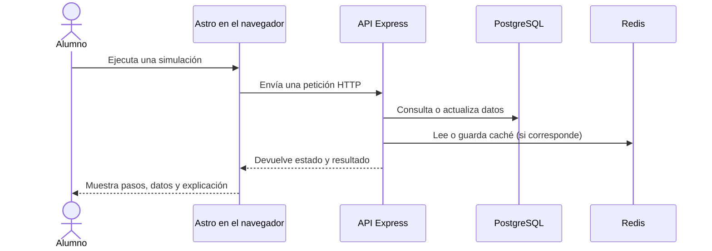

# RunLearn

**RunLearn es un aula virtual interactiva para aprender cómo funciona la web por dentro.** En lugar de limitarse a presentar definiciones, permite recorrer simulaciones paso a paso y observar qué ocurre en el navegador, el servidor y la base de datos.

El proyecto está pensado para estudiantes que comienzan a explorar desarrollo web, backend, seguridad y DevOps. Las demostraciones muestran conceptos como peticiones HTTP, consultas SQL, transacciones, autenticación, caché y contenedores.

## Qué se puede aprender

- Seguir una petición desde la interfaz hasta una API y su respuesta.
- Comparar una consulta SQL vulnerable con una consulta parametrizada.
- Observar `BEGIN`, `COMMIT` y `ROLLBACK` en una transacción.
- Distinguir un acierto y un fallo de caché (`HIT` y `MISS`) con Redis.
- Explorar conceptos de JWT, CSRF, CORS, XSS, hashing y recorrido de rutas.
- Practicar lógica y algoritmos con simulaciones controladas.

Las vistas explicativas combinan diagramas, código o consola, controles paso a paso y explicaciones. Las funciones que necesitan servicios externos muestran un aviso si el backend no está disponible; las simulaciones locales continúan funcionando.

### Flujo de una demostración conectada



## Tecnologías

| Área | Tecnología | Uso |
| --- | --- | --- |
| Sitio web | Astro 5, salida estática | Páginas, navegación y catálogo de clases |
| Interfaz reactiva | React 19 | Islas para el explorador CRUD y el módulo de GitHub |
| Estilos | CSS propio y Bootstrap CSS | Diseño adaptable y componentes visuales |
| API | Node.js 22 y Express 4 | Endpoints educativos y operaciones de demostración |
| Base de datos | PostgreSQL | Usuarios del backend, personas y datos de simulación |
| Caché | Redis | Demostración de caché y estado de servicios |
| Autenticación del sitio | Supabase Auth | Registro e inicio de sesión en la interfaz |

Node.js **22.x** es la versión requerida. Está indicada en `.nvmrc` y en los `engines` de los manifiestos de paquetes.

## Módulos educativos

El catálogo se mantiene en [`src/data/clases.js`](src/data/clases.js). Actualmente contiene 19 módulos:

| Tema | Módulos |
| --- | --- |
| Backend | API, SSR vs CSR, Colas de mensajes, Transacciones SQL |
| DevOps | Docker |
| Lógica | Algoritmo de número, Recursividad |
| Sistema | Servidor |
| Control de versiones | GitHub |
| Automatización | Bots |
| Redes | HTTP / HTTPS |
| Almacén | Base de datos, Caché con Redis |
| Seguridad | SQL Injection, XSS, Hashing de Contraseñas, JWT Inseguro, CSRF, CORS, Path Traversal |

Algunas vistas son simulaciones locales; otras consultan los endpoints del backend. Las rutas y el nivel de integración están definidos junto a los metadatos de cada clase.

## Estructura del proyecto

```text
RunLearn/
├── src/
│   ├── components/        # Navbar, tarjetas, banners e islas React
│   ├── data/clases.js     # Catálogo de módulos
│   ├── layouts/           # Layout base de Astro
│   ├── lib/               # Cliente API, Supabase y audio
│   ├── pages/              # Inicio, catálogo, autenticación y clases
│   └── styles/             # Tokens y estilos globales
├── backend/
│   ├── src/routes/        # Endpoints Express
│   ├── src/db/            # Pool PostgreSQL y runner de migraciones
│   ├── src/cache/         # Cliente Redis
│   └── db/migrations/     # Esquema y datos de demostración
├── astro.config.mjs
└── README.md
```

## Ejecutar el sitio localmente

### Requisitos

- Node.js 22.x y npm.
- Git para clonar el repositorio.
- Docker Compose solo si también se quiere intentar levantar los servicios locales.

### Frontend

```bash
git clone <URL_DEL_REPOSITORIO>
cd RunLearn
nvm use
npm install
cp .env.example .env
npm run dev
```

Astro muestra la URL local en la terminal; normalmente es `http://localhost:4321`.

El catálogo y las simulaciones locales pueden recorrerse sin configurar Supabase. Para habilitar registro e inicio de sesión, completa `.env`:

```env
PUBLIC_SUPABASE_URL=https://<project-ref>.supabase.co
PUBLIC_SUPABASE_ANON_KEY=<anon-o-publishable-key>
PUBLIC_API_URL=http://localhost:5000
```

En Supabase, habilita el proveedor Email y agrega la URL local a las URL permitidas de autenticación. La clave `PUBLIC_SUPABASE_ANON_KEY` se expone al navegador; **nunca pongas una clave `service_role` en variables `PUBLIC_` ni en el frontend**.

### Backend y servicios

La API puede configurarse con PostgreSQL y Redis locales o con servicios administrados. Copia `backend/.env.example` a `backend/.env` y define, como mínimo, `JWT_SECRET` para firmar tokens del login interno.

```bash
cd backend
cp .env.example .env
npm install
npm run dev
```

El servidor escucha normalmente en `http://localhost:5000`. Al arrancar, ejecuta las migraciones antes de empezar a aceptar solicitudes.

#### Nota sobre PostgreSQL local y progreso

La migración `004_progreso.sql` relaciona el progreso con `auth.users`, una tabla que crea Supabase Auth. El PostgreSQL incluido en `docker-compose.yml` no crea ese esquema por sí solo. Por eso, el Compose actual no es una instalación local completa del backend tal como está: para probar todas las migraciones, configura `DATABASE_URL` con la base PostgreSQL del proyecto Supabase. Si solo necesitas las páginas y simulaciones locales, no hace falta iniciar el backend.

Si necesitas Redis local, puedes iniciar únicamente ese servicio con `docker compose up -d redis` desde `backend/`, o configurar una instancia administrada. La API también puede responder cuando Redis está desconectado, aunque las funciones que dependen de caché no estarán disponibles.

## API del backend

La API está separada del sitio estático. Entre sus rutas principales se encuentran:

| Grupo | Rutas destacadas | Propósito |
| --- | --- | --- |
| Estado y métricas | `GET /api/health`, `GET /api/metrics` | Estado de servicios, tiempo de actividad y solicitudes |
| Autenticación interna | `POST /api/auth/register`, `POST /api/auth/login`, `GET /api/auth/me` | Demo de registro, login y JWT local |
| Personas | `GET/POST /api/people`, `GET/PUT/DELETE /api/people/:id` | Simulador CRUD protegido con Bearer token |
| Progreso | `GET/PUT /api/progreso` | Progreso asociado a la identidad de Supabase Auth |
| Caché | `GET /api/cache-demo/:key` | Recorrido de caché HIT/MISS |
| Transacciones | `POST /api/transaccion-demo` | Transferencia de demostración y rollback |
| Seguridad | `/api/sqli-demo`, `/api/hash-demo`, `/api/jwt-demo`, `/api/csrf-demo`, `/api/cors-demo`, `/api/path-traversal-demo` | Demos controladas de vulnerabilidades y mitigaciones |

Las rutas vulnerables son **demostraciones educativas intencionales**. No deben reutilizarse como patrones de producción ni exponerse en un despliegue público sin evaluar y limitar el acceso.

El frontend centraliza las llamadas al backend en `src/lib/apiClient.js`; `PUBLIC_API_URL` debe apuntar al servicio backend, no al dominio del frontend.

## Variables de entorno

### Frontend (`.env` en la raíz)

| Variable | Requerida para | Descripción |
| --- | --- | --- |
| `PUBLIC_SUPABASE_URL` | Autenticación | URL del proyecto Supabase |
| `PUBLIC_SUPABASE_ANON_KEY` | Autenticación | Clave pública para el cliente del navegador |
| `PUBLIC_API_URL` | Demos conectadas | URL base del backend Express |

En desarrollo, el cliente puede usar `http://localhost:5000` como fallback. En producción configura la URL HTTPS real del backend.

### Backend (`backend/.env`)

| Variable | Uso |
| --- | --- |
| `PORT`, `NODE_ENV` | Puerto y entorno del servidor |
| `JWT_SECRET` | Firma de tokens de la autenticación interna |
| `SUPABASE_URL` | Validación de tokens de Supabase y configuración de progreso |
| `SUPABASE_JWT_SECRET` | Opcional; validación de tokens Supabase legacy HS256 |
| `CORS_ORIGINS` | Orígenes permitidos, separados por coma |
| `DATABASE_URL` | Connection string PostgreSQL; tiene prioridad sobre `PG_*` |
| `PG_HOST`, `PG_PORT`, `PG_USER`, `PG_PASSWORD`, `PG_DATABASE` | Conexión PostgreSQL local alternativa |
| `REDIS_URL` | Connection string Redis; admite `rediss://` |
| `REDIS_HOST`, `REDIS_PORT`, `REDIS_PASSWORD` | Conexión Redis local alternativa |

No subas archivos `.env`, contraseñas ni secretos al repositorio. En producción, genera un `JWT_SECRET` aleatorio de al menos 32 bytes y configura `CORS_ORIGINS` con el dominio exacto del frontend.

## Despliegue

### Frontend estático

El proyecto genera el sitio en `dist/` mediante `npm run build`. Puede desplegarse en Vercel como proyecto Astro:

- Comando de instalación: `npm install`
- Comando de build: `npm run build`
- Directorio de salida: `dist`
- Versión de Node.js: `22.x`
- Variables: `PUBLIC_SUPABASE_URL`, `PUBLIC_SUPABASE_ANON_KEY` y `PUBLIC_API_URL`

### Backend

El backend puede desplegarse como servicio Node.js en Render u otro proveedor compatible:

- Directorio raíz: `backend`
- Instalación: `npm install`
- Inicio: `npm start`
- Entorno: `NODE_ENV=production`, `JWT_SECRET`, `CORS_ORIGINS`, `DATABASE_URL` y `REDIS_URL`

El proceso ejecuta las migraciones al iniciar. Configura `CORS_ORIGINS` con el dominio público del frontend y usa conexiones PostgreSQL/Redis seguras para producción.

## Comandos

```bash
# Frontend, desde la raíz
npm run dev       # Desarrollo con Astro
npm run build     # Generar el sitio estático en dist/
npm run preview   # Previsualizar el build localmente

# Backend, desde backend/
npm run dev       # Express con reinicio al cambiar archivos
npm start         # Servidor backend
npm run migrate   # Ejecutar migraciones manualmente
```

## Añadir una clase

1. Agrega sus metadatos en `src/data/clases.js`.
2. Crea la página Astro dentro de `src/pages/`.
3. Si necesita backend, implementa su endpoint en `backend/src/routes/` y consume la API mediante `src/lib/apiClient.js`.
4. Ejecuta `npm run build` y comprueba la ruta en el navegador.

## Licencia

Este repositorio no declara una licencia de uso. Consulta al responsable del proyecto antes de reutilizar o distribuir el código.
