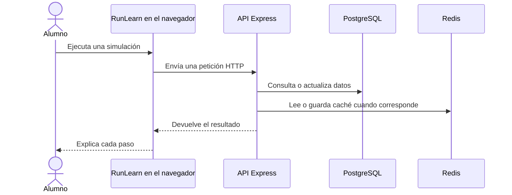

<div align="center">

# RunLearn

### Aprendé cómo funciona la web por dentro.

Un aula interactiva para explorar **backend, seguridad y DevOps** ejecutando cada paso. Seguí una petición, probá una vulnerabilidad en un entorno controlado y mirá cómo responde el sistema.

[](https://run-learn.vercel.app)
[](https://astro.build/)
[](https://nodejs.org/)
[](#licencia)

[Explorar clases](https://run-learn.vercel.app/clases) · [Ver el código](https://github.com/EnzoPatino/RunLearn) · [Cómo ejecutarlo localmente](#empezar-en-local)

</div>

---

> **Nada de magia.** Ejecutás una simulación y observás qué pasa en el cliente, el servidor y la base de datos, incluso cuando algo sale mal.

## Aprendé haciendo

| Seguí el recorrido | Probá escenarios | Entendé el resultado |
| --- | --- | --- |
| Observá peticiones HTTP desde la interfaz hasta la API. | Compará SQL vulnerable y parametrizado en demos controladas. | Revisá consultas, headers, respuestas y cambios de estado. |
| Explorá el ciclo de vida de una petición, una transacción o una tarea en cola. | Provocá aciertos y fallos de caché; probá defensas contra ataques. | Avanzá paso a paso con diagramas, terminales y explicaciones. |

### Una petición, paso a paso



## El aula

RunLearn reúne **23 clases en 9 categorías**, desde los fundamentos de la web hasta seguridad y producción. El catálogo completo vive en [`src/data/clases.js`](src/data/clases.js).

| Ruta de aprendizaje | Temas |
| --- | --- |
| **Fundamentos** | HTTP / HTTPS, API, base de datos |
| **Lógica** | Algoritmo de número, recursividad |
| **Backend** | SSR vs CSR, colas, transacciones SQL |
| **Seguridad** | SQL Injection, XSS, CSRF, CORS, hashing, JWT, Path Traversal |
| **Producción** | Docker, servidor, GitHub, bots, caché con Redis |

Las clases combinan controles interactivos, diagramas, consola o código y explicaciones. Algunas simulaciones funcionan enteramente en el navegador; otras usan servicios del backend y muestran un aviso cuando no están disponibles.

## Cómo está construido

| Parte | Herramientas |
| --- | --- |
| Sitio estático y navegación | Astro 5, JavaScript y CSS |
| Interacciones con estado | React 19 en islas puntuales |
| Identidad y progreso | Supabase Auth |
| API educativa | Node.js 22 y Express 4 |
| Datos y caché | PostgreSQL y Redis |
| Despliegue del sitio | Vercel |

Astro entrega páginas estáticas; React se reserva para simuladores que necesitan estado reactivo. Las solicitudes al backend pasan por [`src/lib/apiClient.js`](src/lib/apiClient.js).

## Empezar en local

### Requisitos

- Node.js **22.x** y npm.
- Git.
- Supabase solo para registro, inicio de sesión y sincronización del progreso.
- PostgreSQL y Redis solo para ejecutar el backend completo.

### 1. Instalar el sitio

```bash
git clone https://github.com/EnzoPatino/RunLearn.git
cd RunLearn
nvm use                 # si usás nvm; la versión del proyecto está en .nvmrc
npm install
cp .env.example .env
npm run dev
```

Astro muestra la dirección local en la terminal (por defecto, `http://localhost:4321`). El catálogo y las simulaciones locales se pueden recorrer sin configurar Supabase ni iniciar el backend.

Para habilitar autenticación, configura las variables de Supabase en `.env`:

```env
PUBLIC_SUPABASE_URL=https://<project-ref>.supabase.co
PUBLIC_SUPABASE_ANON_KEY=<anon-o-publishable-key>
PUBLIC_API_URL=http://localhost:5000
```

Habilitá el proveedor Email y agrega la dirección local a las URL permitidas de autenticación en Supabase. La clave `PUBLIC_SUPABASE_ANON_KEY` está diseñada para el cliente del navegador; **nunca expongas una clave `service_role` en una variable `PUBLIC_`**.

### 2. Iniciar el backend (opcional)

El backend requiere PostgreSQL. La migración de progreso referencia `auth.users`, que crea Supabase Auth; para el backend completo, conectá `DATABASE_URL` a la base PostgreSQL de Supabase. Redis se usa en las demostraciones de caché y puede levantarse localmente.

```bash
cd backend
cp .env.example .env
# Configurá DATABASE_URL y JWT_SECRET en .env
# Opcional: docker compose up -d redis
npm install
npm run dev
```

El servidor usa `http://localhost:5000` por defecto. El PostgreSQL de Docker Compose sirve para pruebas de las tablas locales, pero no incluye el esquema `auth` de Supabase requerido por la migración de progreso. Para ejecutar todas las funciones del backend, usa una base de Supabase.

## API educativa

La base de rutas es `/api`. Ejemplos disponibles:

| Ruta | Uso |
| --- | --- |
| `GET /api/health` · `GET /api/metrics` | Estado de servicios y métricas de solicitudes |
| `POST /api/auth/register` · `POST /api/auth/login` · `GET /api/auth/me` | Demostración de autenticación local |
| `GET`, `POST /api/people` · `GET`, `PUT`, `DELETE /api/people/:id` | Operaciones CRUD del simulador de personas |
| `GET /api/progreso` · `PUT /api/progreso` | Leer y actualizar progreso autenticado |
| `GET /api/cache-demo/:key` · `POST /api/cache-demo/invalidate` | Consultar e invalidar entradas Redis |
| `GET /api/transaccion-demo/cuentas` · `POST /api/transaccion-demo/transferir` | Recorrer una transacción y su resultado |
| `/api/sqli-demo` · `/api/hash-demo` · `/api/jwt-demo` | Demos controladas de seguridad |
| `/api/csrf-demo` · `/api/cors-demo` · `/api/path-traversal-demo` | Explorar riesgos y sus mitigaciones |

Los ejemplos vulnerables son **intencionales y exclusivamente educativos**. No los uses como patrones de producción ni los expongas públicamente sin controles adecuados.

## Variables del backend

El detalle y los valores de desarrollo están en [`backend/.env.example`](backend/.env.example). Las principales variables son:

| Variable | Para qué sirve |
| --- | --- |
| `JWT_SECRET` | Firmar tokens de la autenticación local |
| `SUPABASE_URL` | Validar tokens y asociar progreso de Supabase |
| `CORS_ORIGINS` | Restringir qué sitios pueden llamar a la API |
| `DATABASE_URL` o `PG_HOST`, `PG_PORT`, `PG_USER`, `PG_PASSWORD`, `PG_DATABASE` | Conectar PostgreSQL |
| `REDIS_URL` o `REDIS_HOST`, `REDIS_PORT`, `REDIS_PASSWORD` | Conectar Redis |
| `PORT`, `NODE_ENV` | Puerto y entorno del servidor |

No subas `.env`, contraseñas ni secretos. En producción usa un `JWT_SECRET` aleatorio y limita `CORS_ORIGINS` al dominio del sitio.

## Compilar y publicar

```bash
# Sitio estático, desde la raíz
npm run build
npm run preview

# Backend, desde backend/
npm start
npm run migrate
```

El build del frontend se genera en `dist/`. En Vercel usa Node.js `22.x`, `npm run build` y `dist` como directorio de salida. Configura `PUBLIC_SUPABASE_URL`, `PUBLIC_SUPABASE_ANON_KEY` y `PUBLIC_API_URL` en el proyecto.

El backend puede desplegarse como servicio Node.js en Render u otro proveedor compatible. Configura `NODE_ENV=production`, `JWT_SECRET`, `CORS_ORIGINS`, PostgreSQL y Redis. El backend ejecuta las migraciones antes de aceptar solicitudes.

## Agregar una clase

1. Agrega sus metadatos en `src/data/clases.js`.
2. Crea la vista Astro en `src/pages/`.
3. Si necesita un endpoint, implementalo en `backend/src/routes/` y consumilo mediante `src/lib/apiClient.js`.
4. Ejecuta `npm run build` y comprueba la clase en `/clases`.

## Licencia

Este repositorio no declara una licencia de uso. Consulta al responsable antes de reutilizar o distribuir el código.
